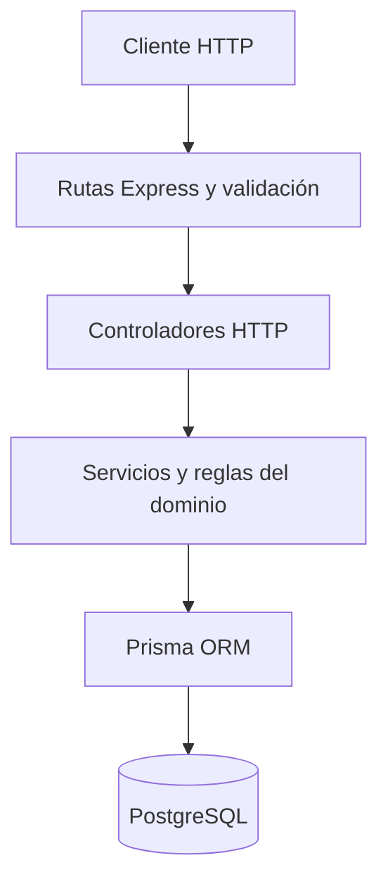
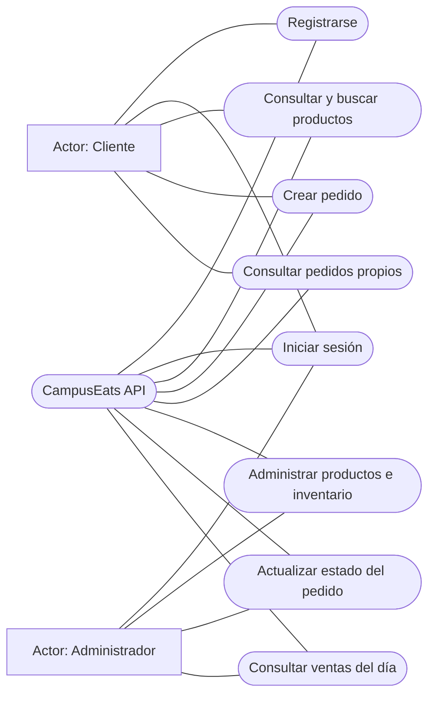
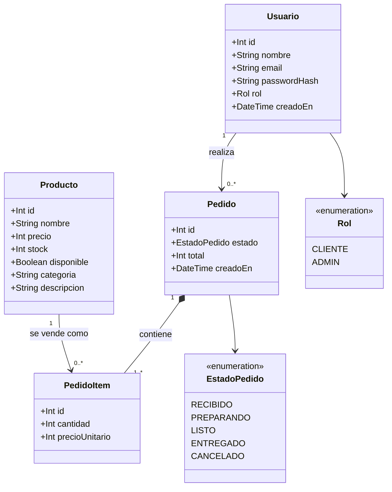
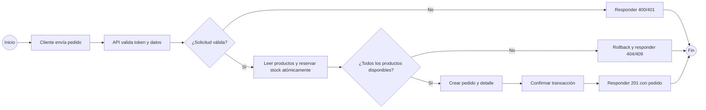

# Modelado del dominio CampusEats

## Hito 1: dominio y alcance

**Dominio elegido:** pedidos de comida de la cafetería universitaria.

**Usuarios:** clientes que consultan el menú y hacen pedidos; administradores de la cafetería que mantienen el catálogo, gestionan el inventario y actualizan pedidos.

**Recursos principales:** usuarios, productos, pedidos e ítems de pedido.

**Transacción principal:** un cliente crea un pedido con uno o más productos. El sistema verifica disponibilidad e inventario, calcula el total y descuenta las existencias en una transacción atómica. Si no alcanza el inventario, responde `409 Conflict` y revierte todos los cambios.

**Integrante:** Juan Manuel Correa Quiceno. El estudiante confirma que consultó con el profesor y tiene autorización para desarrollar el proyecto individualmente.

## Arquitectura

El proyecto es un monolito modular organizado por capas:



Las rutas validan forma y permisos; los controladores adaptan HTTP al dominio; los servicios contienen reglas de negocio y transacciones; Prisma accede a PostgreSQL.

## Diagrama de casos de uso



## Diagrama de clases del dominio



## Diagrama de secuencia de la transacción principal

```mermaid
sequenceDiagram
    actor Cliente
    participant API as Express API
    participant Auth as Middleware JWT
    participant Servicio as Servicio de pedidos
    participant DB as PostgreSQL mediante Prisma
    Cliente->>API: POST /api/pedidos + items
    API->>Auth: Verificar Bearer JWT
    Auth-->>API: identidad CLIENTE
    API->>Servicio: crearPedido(usuarioId, items)
    Servicio->>DB: BEGIN
    loop Cada ítem del pedido
        Servicio->>DB: Leer producto y precio
        Servicio->>DB: UPDATE stock WHERE stock >= cantidad
        alt Producto ausente o sin stock suficiente
            DB-->>Servicio: cero filas o producto inexistente
            Servicio->>DB: ROLLBACK
            Servicio-->>API: 404 o 409
            API-->>Cliente: Error; inventario intacto
        else Stock reservado de forma atómica
            DB-->>Servicio: fila actualizada
        end
    end
    Servicio->>DB: Crear Pedido y PedidoItems
    Servicio->>DB: COMMIT
    DB-->>Servicio: Pedido persistido
    Servicio-->>API: Pedido sin datos sensibles
    API-->>Cliente: 201 Created
```

## Diagrama BPMN del proceso principal

El archivo [pedido.bpmn](./diagramas/pedido.bpmn) contiene el proceso BPMN 2.0 con carriles para Cliente, API y base de datos. El flujo resumido es:



El diagrama de casos de uso también está disponible como fuente PlantUML en [casos-de-uso.puml](./diagramas/casos-de-uso.puml).
